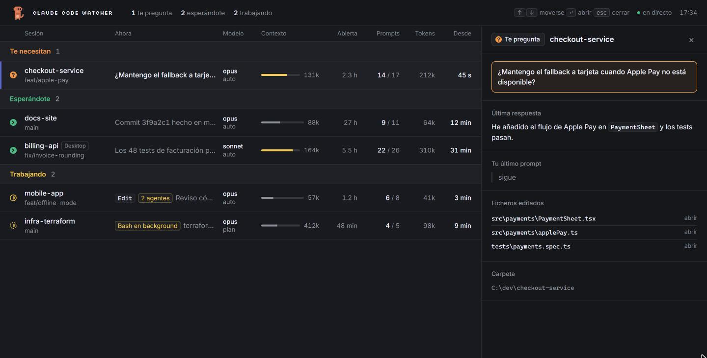

<p align="center">
  
</p>

# cc-suricata · Claude Code Watcher

All your Claude Code sessions on one local page, at a glance: what each one is doing, which one is waiting for you, which one is asking you something, model, context usage, background tasks and agents. Sends a Windows notification when a session finishes its turn or asks you a question.



It does not touch Claude Code's configuration: it reads `~/.claude/sessions/*.json` (the registry of live sessions) and `~/.claude/projects/**/*.jsonl` (transcripts) and reacts to file system changes.

## Usage

```
npx cc-suricata
```

Starts the server at <http://localhost:4747> and opens your browser. Options:

- `PORT=5000 npx cc-suricata` changes the port.
- `--no-open` does not open the browser.
- `--once` prints the sessions as JSON and exits.

Keyboard: `↑` `↓` move, `↵` open the panel, `esc` close it. "open" next to an edited file opens it in VS Code (`code` must be on the PATH).

## What it shows

- Groups: *Need you* (a session is asking you a question), *Waiting for you* (turn finished) and *Working* (running, or with background tasks).
- Per session: name, git branch, what it is doing now, model and permission mode, context usage, time open, prompts and turns, generated tokens and time in the current state.
- Panel: last answer rendered as markdown, last prompt, background commands, edited files.

## How it works

Claude Code already keeps everything the watcher needs on disk. The server never talks to Claude Code; it just reads two places:

1. **`~/.claude/sessions/<pid>.json`**: one file per live session, written by Claude Code itself. It carries the session id, name, working directory, `entrypoint` (`cli`, `claude-desktop`, `claude-vscode`, `sdk-*`), `startedAt` and a `status` (`busy`, `idle`, plus transient values such as `shell`). A file whose `pid` is no longer alive is ignored.
2. **`~/.claude/projects/<project>/<sessionId>.jsonl`**: the transcript, appended live. Each line is a JSON record: your prompts (`type: user` with `origin.kind: human`), the model's messages (`type: assistant`, with `usage` and `stop_reason`), tool calls and their results, `file-history-delta` records for every edit, and `ai-title`.

From those two sources it derives, per session:

- **State**: `waiting` when the last tool call is an `AskUserQuestion` without a result; otherwise the registry status, where anything that is not `idle` counts as working. A session that is `idle` but still has background work shows as `background`.
- **What it is doing now**: the last `tool_use` without a matching `tool_result`, or the first line of the last answer.
- **Background tasks and agents**: a `tool_use` with `run_in_background: true` is running until a user record carries its `<tool-use-id>`/`<task-id>` notification, or a `TaskStop` names its task id. A background `Agent` counts as an agent; a foreground `Agent` without result too.
- **Context usage**: `input + cache_read + cache_creation` tokens of the last assistant message, which is what the next request will carry.
- **Model, permission mode, prompt and turn counters**: fields on the last typed prompt and the last assistant message.
- **Generated tokens**: the sum of `output_tokens`, kept incrementally per transcript (only the bytes appended since the last read are parsed).
- **Edited files**: the last eight `file-history-delta` paths, made relative to the session folder.
- **Git branch**: `.git/HEAD` read directly (following a worktree's `gitdir:` file), no `git` process.

### Technical decisions

- **No hooks, no plugin, no configuration.** An earlier version was a Claude Code plugin ("mod"); it could only see its own session, and settings hooks would have to be installed in every machine. Watching the files Claude Code already writes needs nothing and sees every session, including Desktop and VS Code ones.
- **Transcripts are read backwards, in 512 KB chunks.** A transcript can be tens of MB; everything the list needs is in its last few records. The reader walks from the end and stops as soon as it has prompt, answer, title and turn end (or after ~1500 records), so a refresh costs milliseconds. The only full pass, the token tally, is done once and then kept incremental.
- **Push, not polling.** `fs.watch` on both folders (recursive on `projects`) triggers a debounced refresh that is broadcast to the page over Server-Sent Events; a 15 s timer covers anything the watcher misses and keeps the "since" column current.
- **One dependency-free Node file.** `node:http`, `node:fs` and `node:child_process` are enough; the page loads `marked`, `DOMPurify` and `highlight.js` from a CDN with Subresource Integrity, and degrades to plain text without network.
- **Local only, by construction.** The server binds `127.0.0.1` and rejects any request whose `Host` is not `localhost`/`127.0.0.1` (DNS-rebinding guard). `/open` only accepts files the server itself listed for that session, checks they exist, and spawns `Code.exe` without a shell. The `gitdir:` of a worktree is resolved and rejected if it points to a UNC path, so a crafted `.git` file cannot trigger an SMB request.
- **Notifications are a side effect of state changes**, not a separate channel: when a session's derived state moves to *waiting* or *idle*, the server runs `notify.ps1` (WinRT toast + sound). Nothing fires while a session keeps working.
- **Windows first.** The author's machine; see the TODO below for what to generalise.

## Limitations

- The context bar estimates the window (200k, or 1M once it exceeds 200k): Claude Code does not expose it.
- A session stopped at a permission dialog is not distinguished (the registry only says busy/idle).
- The interface is in Spanish.

## Cross-platform TODO

Built and tested on Windows only. On macOS and Linux the server starts and the page works, but these parts are Windows-specific (`server.mjs`, line numbers approximate):

- [ ] **Notifications** (`notifyChanges`, `notify.ps1`): skipped outside Windows. Add `osascript -e 'display notification …'` (or `terminal-notifier`) on macOS and `notify-send` on Linux, picking the command by `process.platform`.
- [ ] **Git branch** (`gitBranch`): the UNC guard only accepts `C:\…` paths, so the branch is always empty on POSIX. Accept absolute POSIX paths there (`path.isAbsolute`) and keep the UNC rejection for Windows only.
- [ ] **Edited file paths** (`readTranscript`): paths are made relative to the session folder with a hard-coded `\`. Use `path.sep`.
- [ ] **Open in VS Code** (`CODE_EXE`): looks for `Code.exe` next to the PATH entry. On POSIX spawn `code` from the PATH directly (no shell).
- [ ] **Sessions registry**: `~/.claude/sessions/*.json` and the `tmpdir()` filter for plugin-spawned sessions are assumed to have the same layout on every OS. Verify on macOS/Linux.
- [ ] **`fs.watch` recursive** on `~/.claude/projects`: supported on macOS and on Linux with Node ≥ 20; verify it fires on new session files.
- [ ] Opening the browser already handles `win32`, `darwin` (`open`) and the rest (`xdg-open`).

## Development

```
git clone https://github.com/mabuenox/cc-suricata
cd cc-suricata
node server.mjs
```

No dependencies. `server.mjs` is the server (SSE at `/events`), `index.html` the page, `notify.ps1` the notification.
