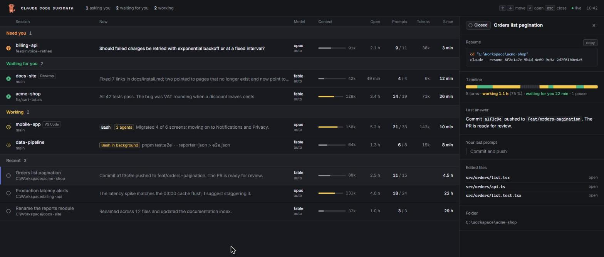
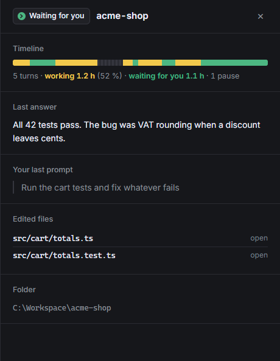

<p align="center">
  
</p>

# cc-suricata · Claude Code Watcher

All your Claude Code sessions on one local page, at a glance: what each one is doing, which one is waiting for you, which one is asking you something, model, context usage, background tasks and agents. Sends a desktop notification when a session finishes its turn or asks you a question.



It does not touch Claude Code's configuration: it reads `~/.claude/sessions/*.json` (the registry of live sessions) and `~/.claude/projects/**/*.jsonl` (transcripts) and reacts to file system changes.

## Usage

```
npx cc-suricata
```

Starts the server at <http://localhost:4747> and opens your browser. Options:

- `PORT=5000 npx cc-suricata` changes the port.
- `--no-open` does not open the browser.
- `--once` prints `{ sessions, findings, recent }` as JSON and exits.
- `--daemon` starts the server detached and exits (what the terminal mod uses).

Keyboard: `↑` `↓` move, `↵` open the panel, `esc` close it. "open" next to an edited file opens it in VS Code (`code` must be on the PATH).

## What it shows

- Groups: *Need you* (a session is asking you a question), *Waiting for you* (turn finished) and *Working* (running, or with background tasks).
- Per session: title (what it is about, the one Claude Code gives it from the first prompt), name and git branch, what it is doing now, model and permission mode, context usage, time open, prompts and turns, generated tokens and time in the current state.
- Panel: last answer rendered as markdown, last prompt, background commands, edited files, and a timeline of the session (working vs. waiting for you, per turn).
- *Recent*: the last 20 closed sessions, with a copyable `claude --resume` command to pick one up again.
- Search (`/`): type a few words and the list becomes the sessions, open or closed, where one of your prompts contains them, with that prompt in the *Now* column. The whole history is searched, not only the recent sessions.
- Next: a strip above the list with the one thing to do first (a session asking you something, however fresh, else the longest wait over 15 min, else a context above 85 %, else a background task older than 30 min). It opens its session. Sessions are named by their title (what they are about), not by the registry name.
- The suricata: one or two sentences written by `claude -p`, shown as the mascot speaking, on what the list does not show by itself (a pattern across sessions, something that does not add up, what to do first and why), never a rephrase of the rows; "Nothing unusual." when there is nothing. Session names are clickable. It is regenerated when a session or a finding comes or goes, at most every two minutes, and only while the page is visible: a minimised tab spends no tokens. Its two lines are reserved, so the list does not jump when it arrives. "again" forces a new one. Needs `claude` on the PATH; without it the strip shows only the findings.

<p align="center"></p>

## In the terminal

The same watch, inside Claude Code, as a plugin:

```
/plugin install cc-suricata --marketplace mabuenox/cc-suricata
```

Answer `y` to add the marketplace, then pick a scope. From then on every session shows what matters about your *other* sessions (the one you are typing in is left out):

- A line above the prompt with the next thing to do, when there is one (`s` opens the pane).
- The counts in the status line: asking, waiting, working.
- A toast when another session starts asking you something.
- `/suricata` opens a pane with the list (title, branch, time in that state, asking first) and the suricata's sentence if the page has asked for one. It is drawn from 110 columns.

The plugin polls `/snapshot` on the cc-suricata server every 5 s and starts it (`--daemon`) when it is not running. `/config` has its two options: the port and whether to start the server.

## How it works

Claude Code already keeps everything the watcher needs on disk. The server never talks to your sessions; it just reads two places (the summary is the one exception: its own `claude -p`, see below):

1. **`~/.claude/sessions/<pid>.json`**: one file per live session, written by Claude Code itself. It carries the session id, name, working directory, `entrypoint` (`cli`, `claude-desktop`, `claude-vscode`, `sdk-*`), `startedAt` and a `status` (`busy`, `idle`, plus transient values such as `shell`). A file whose `pid` is no longer alive is ignored.
2. **`~/.claude/projects/<project>/<sessionId>.jsonl`**: the transcript, appended live. Each line is a JSON record: your prompts (`type: user` with `origin.kind: human`), the model's messages (`type: assistant`, with `usage` and `stop_reason`), tool calls and their results, `file-history-delta` records for every edit, and `ai-title`.

From those two sources it derives, per session:

- **State**: `waiting` when the registry says so (a permission prompt, a plan to approve, a dialog; `waitingFor` gives the reason) or when the last tool call is an `AskUserQuestion` without a result; otherwise the registry status, where anything that is not `idle` counts as working. A session sent to the background keeps its live `bg` probe; the parked front-end, whose status is frozen, is skipped. A session that is `idle` but still has background work shows as `background`.
- **What it is doing now**: the last `tool_use` without a matching `tool_result`, or the first line of the last answer.
- **Background tasks and agents**: a `tool_use` with `run_in_background: true` is running until a user record carries its `<tool-use-id>`/`<task-id>` notification, or a `TaskStop` names its task id. A background `Agent` counts as an agent; a foreground `Agent` without result too.
- **Context usage**: `input + cache_read + cache_creation` tokens of the last assistant message, which is what the next request will carry.
- **Model, permission mode, prompt and turn counters**: fields on the last typed prompt and the last assistant message.
- **Generated tokens**: the sum of `output_tokens`, kept incrementally per transcript (only the bytes appended since the last read are parsed).
- **Edited files**: the last eight `file-history-delta` paths, made relative to the session folder.
- **Git branch**: `.git/HEAD` read directly (following a worktree's `gitdir:` file, and saying "(worktree)" after the branch), no `git` process; a `gitdir:` that resolves to a UNC path is rejected.
- **Timeline**: your prompts and `end_turn` messages, collected in the same incremental pass as the token tally. A prompt opens a *working* segment, an `end_turn` opens a *waiting* one; waits longer than an hour count as pauses. Events older than the current process are ignored, so a resumed session starts a fresh timeline.
- **Recent sessions**: `~/.claude/history.jsonl` (one line per prompt: project, session id, timestamp) is the index; the transcript tail is read once per closed session for title, last answer, model and the branch it was on (each record carries `gitBranch`), and its full timeline only when you open it. The search is a substring match over the prompts in that same index, so a closed session whose transcript Claude Code has already cleaned up cannot be found.

### Technical decisions

- **No hooks, no plugin, no configuration.** An earlier version was a Claude Code plugin ("mod"); it could only see its own session, and settings hooks would have to be installed in every machine. Watching the files Claude Code already writes needs nothing and sees every session, including Desktop and VS Code ones.
- **Transcripts are read backwards, in 512 KB chunks.** A transcript can be tens of MB; everything the list needs is in its last few records. The reader walks from the end and stops as soon as it has prompt, answer, title and turn end (or after ~1500 records), so a refresh costs milliseconds. The only full pass, the token tally, is done once and then kept incremental.
- **Push, not polling.** `fs.watch` on both folders (recursive on `projects`) triggers a debounced refresh that is broadcast to the page over Server-Sent Events; a 15 s timer covers anything the watcher misses and keeps the "since" column current.
- **No dependencies.** A handful of Node files (`server.mjs` serves, `transcript.mjs` parses, `sessions.mjs` indexes, `insights.mjs` draws conclusions, `platform.mjs` knows the OS) with `node:http`, `node:fs` and `node:child_process`; the page loads `marked`, `DOMPurify` and `highlight.js` from a CDN with Subresource Integrity, and degrades to plain text without network.
- **Local only, by construction.** The server binds `127.0.0.1` and rejects any request whose `Host` is not `localhost`/`127.0.0.1` (DNS-rebinding guard) ; `/summary` and `/open` also refuse what a browser marks `Sec-Fetch-Site: cross-site`, so another open site cannot make it run `claude` or VS Code. `/open` only accepts files the server itself listed for that session, checks they exist, and spawns `Code.exe` without a shell. The `gitdir:` of a worktree is resolved and rejected if it points to a UNC path, so a crafted `.git` file cannot trigger an SMB request.
- **Notifications are a side effect of state changes**, not a separate channel: when a session's derived state moves to *waiting* or *idle*, the server runs `notify.ps1` (WinRT toast + sound). Nothing fires while a session keeps working.
- **The summary is a `claude -p` with everything switched off.** `--no-session-persistence --tools "" --settings '{"disableAllHooks":true}' --strict-mcp-config --disable-slash-commands`, prompt over stdin, run from the temp folder: no transcript, no registry file, no history line, so the watcher has nothing to react to (a plain `claude -p` would write all three and take 30 s with plugin hooks; this one takes under 10). It uses your own account and `haiku`; the prompt carries only the findings and one line per live session. Not `--bare`: that only accepts an API key, not a login.
- **Developed on Windows.** macOS and Linux have their own notifier and VS Code lookup, tested only by unit tests; see "Platforms" below.

## Limitations

- The context bar estimates the window (200k, or 1M once it exceeds 200k): Claude Code does not expose it.
- In the timeline, a turn that ends with a question to you is drawn as working until you answer (only `end_turn` closes a turn).

## Platforms

Developed and used on Windows. Linux is checked end to end in a container (`scripts/linux-check.sh`: tests, a fake `~/.claude`, `fs.watch`, and stubbed `notify-send` and `code` that record how they were called). macOS has the same code paths but the author has not run it there; a report of what you see is welcome.

| | Windows | macOS | Linux |
| --- | --- | --- | --- |
| Notification | `notify.ps1` (WinRT toast + sound) | `osascript` (`display notification`) | `notify-send` (libnotify) |
| Open in VS Code | `Code.exe` next to the PATH entry | `code` on the PATH | `code` on the PATH |
| Open the browser | `start` | `open` | `xdg-open` |

The command for each is chosen in `platform.mjs` by `process.platform`; the server spawns it without a shell, so titles and texts are never interpreted. Not yet verified on macOS: that `fs.watch` with `recursive` fires for new transcripts, and that `osascript` shows the notification (it may ask for a permission the first time).

## Development

```
git clone https://github.com/mabuenox/cc-suricata
cd cc-suricata
node server.mjs
```

No dependencies. `server.mjs` is the server (SSE at `/events`), `transcript.mjs` the transcript reader and state derivation (pure, tested), `sessions.mjs` the live registry, closed-session index, prompt search, git branch and open check (tested), `insights.mjs` the findings and the summary prompt and argv (pure, tested), `index.html` + `style.css` + `app.js` the page, `notify.ps1` the notification. `hooks/register.tsx` is the Claude Code plugin (band, status line, toasts, `/suricata` pane; `types/index.d.ts` its state contract), with `.claude-plugin/` making the repository a plugin marketplace; `claude --plugin-dir .` loads it in a session while you edit it.

```
npm test
```

The tests in `test/` run the parser on small anonymised transcripts in `test/fixtures/`, one per case that broke at some point (a pending question, background tasks finished, stopped or still running, a resumed session, a subagent), and the session index, git branch reading and the `/open` check on fixtures and temp folders. They run in CI on every pull request and before each publish. `claude plugin test .` runs the plugin's tests (`hooks/register.test.tsx`) and `claude plugin validate .` checks it the way the engine will.

### Releases

Commits follow [Conventional Commits](https://www.conventionalcommits.org) (`fix:` → patch, `feat:` → minor, `feat!:` → major). On every push to `main`, [release-please](https://github.com/googleapis/release-please) keeps a release PR up to date with the version bump and the changelog; merging it tags the release and publishes to npm from GitHub Actions with [trusted publishing](https://docs.npmjs.com/trusted-publishers) (OIDC, no token).
